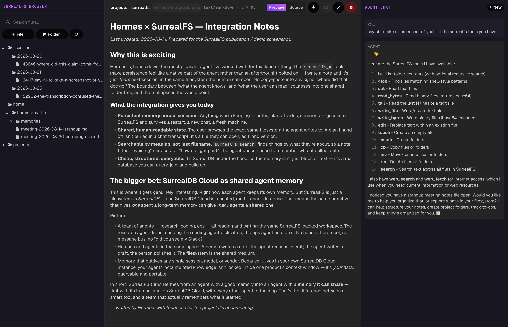

<a href="https://surrealdb.com#gh-dark-mode-only" target="_blank">
    
</a>
<a href="https://surrealdb.com#gh-light-mode-only" target="_blank">
    
</a>

<h1 align="center">SurrealFS</h1>
<p align="center">A filesystem-based memory layer for agents, with hybrid search, backed by SurrealDB.</p>

<p align="center">
    
    &nbsp;
    <a href="https://github.com/surrealdb/surrealfs"></a>
    &nbsp;
    <a href="https://github.com/surrealdb/surrealfs/actions"></a>
    &nbsp;
    <a href="https://www.apache.org/licenses/LICENSE-2.0"></a>
</p>

<p align="center">
    <a href="https://crates.io/crates/surrealdb"></a>
    &nbsp;
    <a href="https://www.npmjs.com/package/surrealdb"></a>
    &nbsp;
    <a href="https://pypi.org/project/surrealdb/"></a>
</p>

<p align="center">
    <a href="https://surrealdb.com/discord"></a>
    &nbsp;
    <a href="https://x.com/surrealdb"></a>
    &nbsp;
    <a href="https://dev.to/surrealdb"></a>
    &nbsp;
    <a href="https://www.linkedin.com/company/surrealdb/"></a>
    &nbsp;
    <a href="https://www.youtube.com/@surrealdb"></a>
</p>

<p align="center">
    <a href="https://surrealdb.com/blog"></a>
    &nbsp;
    <a href="https://github.com/surrealdb/surrealfs"></a>
    &nbsp;
    <a href="https://www.linkedin.com/company/surrealdb/"></a>
    &nbsp;
    <a href="https://x.com/surrealdb"></a>
    &nbsp;
    <a href="https://www.youtube.com/@surrealdb"></a>
    &nbsp;
    <a href="https://dev.to/surrealdb"></a>
    &nbsp;
    <a href="https://surrealdb.com/discord"></a>
    &nbsp;
    <a href="https://stackoverflow.com/questions/tagged/surrealdb"></a>
</p>

<br>

> [!WARNING]
> **SurrealFS is in beta.** The API, schema, and CLI may change in breaking ways
> between releases, and it is not yet recommended for production use. Bug
> reports and feedback are very welcome.

<h2>&nbsp;&nbsp;What is SurrealFS?</h2>

Give an agent somewhere durable to keep its work. SurrealFS is a `file` table plus everything needed to hand it to a model, a person or a program: files and folders, versions, full-text and semantic search, unix-style permissions, and live collaboration, all queryable with SurrealQL because it is just a table.



*The file browser is served by the SurrealFS server and edits the same table the agents write to.*

## What is in the box

One schema, several ways to reach it.

|                                  |                                                                                  |
| -------------------------------- | -------------------------------------------------------------------------------- |
| `surrealfs/schema/`              | The data model: the `file` table, permissions, search and every `fn::sfs_*` function |
| `crates/surrealfs-core`          | The Rust client: files, search, history, workspaces, CRDTs, storage, trust       |
| `crates/surrealfs-server`        | The gateway: REST and RPC, MCP, chat, embeddings, WebDAV, S3, NFS, SFTP, browser UI |
| `crates/surrealfs-cli`           | The `surrealfs` command line and the `git-remote-surrealfs` helper           |
| `crates/surrealfs-fuse`          | Mount a SurrealFS as a local directory                                           |
| `crates/surrealfs-shim`          | A zero-privilege `LD_PRELOAD` interceptor and a WASI adapter                    |
| `crates/surrealfs-sim`           | A deterministic simulator that checks tree, lock and branch invariants          |
| `surrealfs/` (Python)            | The async `SurrealFs` library, agent tool surfaces and the MCP server            |
| `packages/sdk-ts`                | The TypeScript SDK `@surrealdb/fs`                                               |
| `apps/macos-menu`                | A macOS menu bar app with a live activity feed and global search                |
| `worker/`                        | A Cloudflare Worker that runs the gateway as WebAssembly                         |

## Requirements

- A SurrealDB 4.x server. The Rust crates use the `surrealdb` 4.0 SDK.
- Rust (stable) for the server, CLI, FUSE and shim.
- Python 3.11+ for the Python library and MCP server.
- [bun](https://bun.sh) to build the browser UI and run the TypeScript tests.

The TypeScript SDK depends on `surrealdb.js` 2.x, whose version check rejects 4.x servers. Connect with `{ versionCheck: false }` until a release supports 4.0. Live queries (`fs.watch`) are not available from the TypeScript SDK on a 4.x server for the same reason.

## Quickstart

Start a database, initialise the schema once, then start the gateway.

```bash
surreal start --allow-all -u root -p root --bind 127.0.0.1:8000 memory   # or: just db

cargo run -p surrealfs-cli -- init
cargo run -p surrealfs-cli -- write /notes/today.md "# Today"
cargo run -p surrealfs-cli -- cat /notes/today.md
cargo run -p surrealfs-cli -- grep today

just server        # builds the UI, then serves everything on http://127.0.0.1:7933
```

The CLI reads `SURREALDB_URL` (default `ws://127.0.0.1:8000/rpc`), `SURREALDB_NS`, `SURREALDB_DB`, `SURREALDB_USER` and `SURREALDB_PASS`, and `SURREALFS_CALLER` to act as a given user.

## The gateway server

`surrealfs-server` (or `surrealfs serve gateway`) is the single process that exposes a database to everything else.

| Surface          | Path or port                       | Notes                                                       |
| ---------------- | ---------------------------------- | ----------------------------------------------------------- |
| Browser UI       | `/`                                | The React app, served from `SURREALFS_STATIC_DIR`           |
| REST             | `/api/*`, `/raw`                   | Files, tree, search, history, graph, activity, chat, RPC    |
| MCP              | `/mcp`                             | JSON-RPC tools for any MCP client                           |
| WebDAV           | `/dav/*`                           | Mountable from Finder or Explorer; supports locking         |
| S3               | `/s3/*`                            | SigV4 with credentials created by `surrealfs credential` |
| NFS and SFTP     | `serve nfs`, `serve sftp`          | Separate listeners                                          |

Configuration is by environment variable or flag:

| Variable                  | Purpose                                                                  |
| ------------------------- | ------------------------------------------------------------------------ |
| `SURREALDB_URL`           | The database, for example `http://127.0.0.1:8000`                        |
| `SURREALDB_NS`, `SURREALDB_DB` | Namespace and database (defaults `surrealfs` and `main`)            |
| `SURREALDB_USER`, `SURREALDB_PASS`, `SURREALDB_TOKEN` | Credentials the gateway uses                    |
| `SURREALFS_BIND`, `SURREALFS_PORT` | Listen address (default `127.0.0.1:8787`)                       |
| `SURREALFS_SERVER_TOKEN`  | Shared bearer token for trusted callers                                  |
| `SURREALFS_ALLOW_ANONYMOUS` | Set to `1` to serve without a token on a non-loopback address          |
| `OPENAI_API_KEY`          | Enables server-side embeddings and hybrid search                         |
| `ANTHROPIC_API_KEY`       | Enables the chat agent behind `/api/chat`                                |

### Authentication

With `SURREALFS_SERVER_TOKEN` set, a caller sends `Authorization: Bearer <token>` and acts as the user named in `X-SurrealFS-User` (default `root`). Without a token the identity headers are ignored and every request runs as the gateway's own identity, so the server refuses a non-loopback bind unless `SURREALFS_ALLOW_ANONYMOUS=1`.

Credentials for WebDAV, S3, NFS and SFTP are created with `surrealfs credential create`. Secrets are stored as salted PBKDF2-HMAC-SHA256 hashes, except for `s3`, whose signing key has to stay recoverable.

## The command line

`surrealfs` covers the whole surface. A selection:

```bash
surrealfs ls /notes                     # list
surrealfs write /a.md "text"            # write
surrealfs grep "pattern"                # full-text search
surrealfs history /a.md                 # versions
surrealfs restore /a.md 2               # roll back to generation 2
surrealfs fork <src> <dst>              # zero-copy workspace branch
surrealfs diff <branch>                 # what the branch changed
surrealfs merge <src> <dst>             # merge it back
surrealfs mount ~/brain                 # FUSE mount
surrealfs import-git ./repo /code       # import a repository with history
surrealfs pack "how do refunds work"    # context packed to a token budget
surrealfs backup / ./snapshots          # content-addressed backup
surrealfs --help                        # everything else
```

Content is stored in FastCDC chunks addressed by BLAKE3, so large files are deduplicated, range reads are cheap and `du` is instant. Files can be encrypted with AES-256-GCM, shared by link, placed under legal hold, or exported as tar and zip.

## The Python library

The Python package installs its own command as `surrealfs-py`; `surrealfs` is the Rust CLI.

```python
from surrealdb import AsyncSurreal
from surrealfs import SurrealFs, apply_schema

db = AsyncSurreal("ws://localhost:8000/rpc")
await db.signin({"username": "root", "password": "root"})
await db.use("surrealfs", "demo")
await apply_schema(db)  # defines the `file` table; safe to re-run

fs = SurrealFs(db, user="alice")  # who you are; ROOT bypasses permissions
await fs.write_text("/notes/today.md", "# Today\n- ship the refactor")
await fs.edit("/notes/today.md", "ship", "shipped")
await fs.ls("/notes")
await fs.search_text("refactor")
```

```bash
pip install surrealfs                    # core, and the Hermes plugin
pip install "surrealfs[pydantic-ai]"     # + the pydantic-ai toolset
pip install "surrealfs[mcp]"             # + the MCP server
```

You create and own the connection. SurrealFS never connects, signs in, or selects a namespace. `user` is required and has no default: files carry a unix owner and mode, and the database cannot tell SurrealFS who is asking when every credential is a system credential, so the identity comes from you. See [Permissions](#permissions).

`SurrealFs` returns structured `FileEntry` and `SearchHit` objects, not pre-formatted strings.

|          |                                                               |
| -------- | ------------------------------------------------------------- |
| Read     | `read_text` `read_bytes` `tail` `ls` `glob` `stat` `exists`   |
| Write    | `write_text` `write_bytes` `edit` `touch` `mkdir`             |
| Organise | `mv` `cp` `rm` `chmod`                                        |
| Search   | `search` `search_text` `search_semantic` `reindex_embeddings` |

### Agent integrations

Six ways to hand it to an agent, each with its own README:

|                                                                          |                                                                       |                          |
| ------------------------------------------------------------------------ | --------------------------------------------------------------------- | ------------------------ |
| **[pydantic-ai](surrealfs/integrations/pydantic_ai/README.md)**          | a `FunctionToolset`, with recoverable mistakes raised as `ModelRetry` | `surrealfs[pydantic-ai]` |
| **[Raw JSON tool schemas](surrealfs/integrations/json_tools/README.md)** | plain dicts in Anthropic or OpenAI shape, no framework                | core                     |
| **[Hermes](surrealfs/integrations/hermes/README.md)**                    | the 14 `surrealfs_*` tools plus a bundled notes skill                 | core                     |
| **[Hermes memory](surrealfs/integrations/hermes_memory/README.md)**      | files every completed turn, and recalls context before each one       | core                     |
| **[MCP](surrealfs/integrations/mcp/README.md)**                          | the 16 tools over stdio, for Claude, Cursor, Zed, Codex or your own   | `surrealfs[mcp]`         |
| **[Claude](surrealfs/integrations/claude/README.md)**                    | that server as a plugin, bundled with the `/brain` skill              | `surrealfs[mcp,agent-memory]` |

The tool surfaces are generated from one registry in `surrealfs/tools/`, so they cannot drift apart. Tool descriptions are markdown in `surrealfs/tools/docs/`. Edit them as prose; they are prompt text. The gateway also exposes the same tools over HTTP at `/mcp`.

## The TypeScript SDK

`packages/sdk-ts` is `@surrealdb/fs`: the same operations over a `surrealdb` connection, plus an AI tool adapter (`@surrealdb/fs/ai`) and the schema as a string for `applySchema`.

```bash
cd packages/sdk-ts && bun install && bun test
```

## Mounting and intercepting

- **FUSE.** `surrealfs mount <dir>` mounts a filesystem, including a synthetic `/proc`-style tree and extended attributes for metadata.
- **Shim.** `surrealfs-shim` redirects `/surrealfs/...` paths to SurrealFS for any program, without privileges, using `LD_PRELOAD`. A WASI adapter does the same for WebAssembly guests.
- **macOS menu bar.** `apps/macos-menu` shows connection state, mounts a profile, streams agent activity with one-click undo and offers a global search window (`swift build` and `swift test` in that directory).

## Deploying on Cloudflare

The gateway compiles to WebAssembly and runs in a Worker, talking to SurrealDB over HTTP. The static UI is served from Workers Assets.

```bash
rustup target add wasm32-unknown-unknown
cargo install wasm-bindgen-cli          # the version must match the wasm-bindgen crate
just ui                                  # build the browser UI
npx wrangler secret put SURREALDB_URL    # for example https://your-instance.surreal.cloud
npx wrangler secret put SURREALDB_USER
npx wrangler secret put SURREALDB_PASS
npx wrangler secret put SURREALFS_SERVER_TOKEN
just deploy                              # wrangler runs the cargo and wasm-bindgen build
```

Apply the schema to the target database once with `surrealfs init` (or `python -m surrealfs.schema`). `OPENAI_API_KEY` and `ANTHROPIC_API_KEY` are optional secrets that enable embeddings and chat. To try the Worker without deploying, run `npx wrangler dev --local --var SURREALDB_URL:http://127.0.0.1:8000 --var SURREALDB_USER:root --var SURREALDB_PASS:root`.

## Semantic search

`fs.search` runs a full-text arm and a vector arm and fuses them by rank. SurrealFS never calls an embedding model: you pass the embedder, so you pick the provider, and without one search stays full-text only. The gateway embeds files on write through the OpenAI embeddings API when `OPENAI_API_KEY` is set (`OPENAI_BASE_URL` and `SURREALFS_EMBED_MODEL` point it elsewhere), and from Python you pass your own embedder to `reindex_embeddings`.

The queries are custom SurrealQL functions in the schema, so any client gets the same ranked, permission-filtered retrieval:

```surql
SELECT path, rrf_score FROM fn::sfs_hybrid_search("how do I get paid", $qvec, 5, NONE, 'alice');
```

`fn::sfs_search_text`, `fn::sfs_search_semantic` and `fn::sfs_search_sections` are the single arms. The last argument is who is asking: a system credential passes it, a record credential overrides it. See [Semantic search](docs/semantic-search.md) for the ranking, `match="all"` and the SurrealQL surface.

## Permissions

Files carry a unix `owner` and `mode`, `/home/<user>` is private, everything else is shared, and `chmod` moves things between the two. Groups, share links and legal holds build on that. The client enforces it, and the schema can enforce it too. See [Permissions](docs/permissions.md) for the rules and the reasoning.

### Letting the database enforce it too (optional)

Client-side enforcement is a real boundary for an agent, since no tool exposes raw SurrealQL, but not against anyone holding a database credential. If several agents share a database, opt in:

```bash
python -m surrealfs.schema --record-auth   # adds the `user` table + record access
python -m surrealfs.users add alice        # creates alice and /home/alice (0700)
```

Then connect as that record user (`SURREALDB_AUTH_LEVEL=record SURREALDB_USER=alice SURREALDB_PASS=…`). SurrealDB itself refuses to return or modify anything in another user's home, whatever query it is asked. A parent folder the caller cannot read is treated as closed, so a hidden folder never opens its children. Deployments that do not opt in are unaffected: the permissions clause is inert for system credentials.

## The schema

`surrealfs/schema/file.surql` is the whole data model, and it is worth reading. The key idea: a file's `parent` is a record link and `path` is a **computed** field derived from the parent chain. Nothing stores a path, so renaming or moving a folder is a single `UPDATE` and every descendant's path follows for free.

```surql
DEFINE FIELD path ON file COMPUTED (
    ($this.parent.path || '') + '/' + <string>$this.filename
) TYPE string;
```

A folder is a row with no `content`, no `file` bytes and no `symlink`, also computed, as `is_folder`. `hash` is maintained by an event, and there are HNSW and BM25 indexes for the two search modes. `owner`, `mode` and the computed `gate` are the permission model.

Apply it without writing code:

```bash
surrealfs init                              # from Rust
python -m surrealfs.schema                     # uses SURREALDB_* env vars
python -m surrealfs.schema --print             # dump the DDL, connect to nothing
```

Two engine behaviours shape how the schema is written. Function parameters must not be named `$parent` or `$token`, which SurrealDB 4 shadows or reserves. A KNN operator cannot share a `WHERE` clause with a predicate on a variable derived from a function call, so section search scans first and filters its candidates in a second query.

## Development

```bash
just db        # start SurrealDB in one terminal
just schema    # apply the file table to it
just server    # the gateway and browser UI on :7933
just ui-dev    # vite dev server, proxying the API to `just server`
just test      # the Python suite (starts its own server)
just lint      # ruff and `surreal validate`
```

Every suite starts a throwaway `surreal` server from your `PATH`, which must be 4.x. Set `SURREALFS_TEST_URL` to reuse one you already have.

```bash
cargo test --workspace                  # Rust
uv run pytest                           # Python
(cd packages/sdk-ts && bun test)        # TypeScript SDK
(cd surrealfs/browser/ui && bun test)   # browser UI
cargo check -p surrealfs-core -p surrealfs-server --target wasm32-unknown-unknown   # Worker build
```

CI runs all of these on every pull request.
